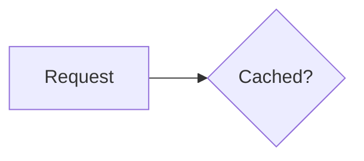

# adev

The look of [angular.dev](https://angular.dev), the Angular documentation site: Inter type, hairline grey borders, four pixel corners, the pink to purple to blue gradient used sparingly, and alerts, cards and code blocks drawn like the docs. Light and dark. Install it with `npm i -D @slide-ng/theme-adev` and use it with `theme: adev`.

This theme is inspired by angular.dev. It is not an official Angular theme, and slide.ng is a community project that is not affiliated with or endorsed by Google or the Angular team.

## What is taken from adev

- Tokens: the grey scale (`gray-1000` to `gray-50`), the accent colours (bright blue, electric violet, vivid pink, hot pink, orange red) and the dark mode mixes, as `--adev-*` CSS variables in `styles/tokens.css`. Light and dark are set by the theme's own switch (see below).
- slide.ng's accent colour (`--slidev-theme-primary`: the progress bar, the presenter's click preview, the sync menu) is a light violet, `#9d5cff`, because the dock and menus stay dark.
- Fonts (`theme.json`, from the font provider): `Inter` for text, `Inter Tight` for headings, `DM Mono` for code, weights 400 and 500.
- Gradients: the hero (hot pink to electric violet) on `cover`, `end` and the picture side of `image-left` and `image-right`; the red, pink, purple text gradient on `intro`, `fact` and stat numbers; the pink to purple ring of numbered steps and `adev-button`.
- Code: the same Shiki themes as angular.dev, `github-light` and `github-dark`, set in `theme.json` (white panel with dark text in light, `#24292e` panel with `#e1e4e8` text in dark, as in angular.dev's `docs-light-mode` and `docs-dark-mode`). A hairline border, 14px DM Mono, and a header bar with the file name in the purple to blue gradient (a fence title such as `[app.ts]`, or `<adev-code-card>`). Inline code is hot pink on a light purple tint.
- Alerts, cards, buttons, steps, tables and links follow the docs styles.

## Layouts

`cover`, `intro`, `default`, `center`, `section`, `two-cols`, `image-right`, `image-left`, `quote`, `fact`, `statement` and `end`. The other built-in layouts (`two-cols-header`, `full`, `image`, `iframe`, `none`) pick up the colours and type from the CSS.

`cover` keeps the `background` input. `image-left` and `image-right` draw the gradient picture side when no `image` is set.

## Light and dark

Both schemes are complete and follow angular.dev's light and dark: every layout, component, alert tint, gradient, border and code colour has a variant for each. The theme has its own switch, a small sun or moon button in the top right corner of every slide (top left in a right-to-left deck, and the bottom corner when the navigation bar is at the top: slide.ng 2.1's `navPosition`, or a place chosen in the settings menu of 2.2) (`aria-label` "Switch slide colour scheme", a toggle button that works from the keyboard). It only recolours the slides: the slide.ng dock, its menus and the page colour schema (`colorSchema`, the sun button of the dock) are not touched, and the theme does not react to them.

The scheme is an attribute on the page, `data-adev-scheme="light|dark"`. The first value is the choice stored in `localStorage` (key `adev-scheme`), else the system preference, else light, so `slide-ng export --dark` starts dark. Every change is stored, and the presenter and the main window follow each other. The button is not drawn in print, export, overview or the next-slide preview, but those use the same scheme. The hero panels (`cover`, `end`, the picture side of the image layouts) look the same in both, as on angular.dev. The tests check the layouts, components, code colours and text contrast in both schemes by setting the attribute, and that the button leaves the dock alone.

## Angular support built in

Angular code is highlighted out of the box, with no setup file: the theme loads the `angular-ts` and `angular-html` grammars (`setup/shiki.ts`) and adds the fence names `ng-ts`, `ng-html` and `angular` (`ng` works in slide.ng already). `@Component` decorators with inline templates, control flow (`@if`, `@for`, `@defer`, `@switch`), bindings, `{{ }}` and pipes are coloured like on angular.dev. A deck that sets its own `codeAliases` replaces these names.

## Components

Every component is a tag you write in the Markdown of a slide. A tag that holds Markdown needs a blank line after the opening tag and before the closing tag.

### Alerts

`<adev-alert kind="note">` with ten kinds: `note`, `tip`, `todo`, `question`, `summary`, `tldr`, `warning`, `critical`, `important` and `helpful`. `title="..."` replaces the label, `bare` drops it.

```md
<adev-alert kind="tip" title="Handy">Use `computed()` for derived state.</adev-alert>
```

A paragraph that starts with a kind in capitals, a colon and a space becomes an alert too (the nine angular.dev kinds, in capitals; `warning` is only available as a tag). The alert ends at the blank line, and braces are safe.

```md
NOTE: A paragraph that starts with the kind becomes an **alert**.
```

### Pills

```md
<adev-pill-row>
<adev-pill title="Signals"></adev-pill>
<adev-pill href="https://angular.dev" title="angular.dev"></adev-pill>
</adev-pill-row>
```

### API item labels

`<adev-api-label kind="class">` is a small badge. Kinds: `class`, `const`, `decorator`, `directive`, `element`, `enum`, `function`, `interface`, `pipe`, `ng-module`, `type-alias`, `block`, and the status kinds `deprecated`, `developer-preview`, `experimental`, `stable`. `full` shows the name, `version="v20"` adds a version.

```md
<adev-api-label kind="deprecated" full version="v20"></adev-api-label>
```

### Keyboard keys

`<kbd>Ctrl</kbd>` or `<adev-kbd>Ctrl</adev-kbd>`.

### Decorative header

`<adev-decorative-header title="What is Angular?" imgSrc="/logo.svg" imgAlt="...">Text</adev-decorative-header>`. `gradient` draws it on the brand panel.

### Prefer and avoid

A fence with `{prefer}` or `{avoid}` becomes a green or red card. `[file.ts]` is the card title.

````md
```ts {prefer} [counter.ts]
const count = signal(0);
```
````

The same cards as tags, with text or a code block inside: `<adev-prefer title="...">` and `<adev-avoid title="...">`.

### Code card options

A plain fence shows the file name from `[app.ts]` in the header. `{2,4-5}` highlights lines and dims the rest, `{lines:true}` shows line numbers, and `// [!code ++]` and `// [!code --]` mark added and removed lines. The copy button appears when you hover a card.

````md
```ts [user.ts] {2,4-5} {lines:true}
name = input.required<string>(); // [!code ++]
```
````

`<adev-code-card title="app.ts" label="TypeScript">` puts a header over a fence you write inside it.

### Code groups

Files in tabs, one fence per file:

````md
::code-group

```ts [app.ts]
export class App {}
```

```html [app.html]
<h1>Hello</h1>
```

::
````

### Snippet import

`<<< ./snippets/user.component.ts#greeting ts` shows a file, or one `#region`, in a code card with its file name and language. A deck that already wraps the line in a tag is left alone.

### Tabs

```md
<adev-tab-group label="Package manager">
<adev-tab label="npm">

`npm install`

</adev-tab>
<adev-tab label="pnpm">

`pnpm add`

</adev-tab>
</adev-tab-group>
```

Arrow keys, Home and End move between tabs. `clicks` on the group shows one tab per click.

### Images

Markdown images get a hairline border and rounded corners. Add `#small` or `#medium` to the URL for a smaller image: ``.

`<adev-image src="/photo.png" alt="..." caption="..." size="medium" />` adds a caption.

### Video

`<adev-video src="https://www.youtube.com/embed/ID" title="Talk" />` shows a poster card first and loads the player on click. Print and export show the poster only.

### Mermaid

Mermaid fences take their colours, fonts and pie slice colours from the theme, in light and dark, with no setup:

````md

````

### Other

| Tag                                        | What it is                                                                                      |
| ------------------------------------------ | ----------------------------------------------------------------------------------------------- |
| `<adev-card-grid cols="3">`, `<adev-card>` | A grid of cards. `<adev-card label="Step 1" title="Fork" hot>` (`hot` adds the gradient border) |
| `<adev-stat value="15+" label="PRs">`      | A big gradient number with a label                                                              |
| `<adev-count-up to="240" suffix="+">`      | A number that counts up when its slide appears (shows the final value in print and previews)    |
| `<adev-steps>`                             | An ordered list with numbered gradient rings                                                    |
| `<adev-button variant="secondary">`        | The primary (gradient outline) or secondary button                                              |

Headings, tables, links (external links get an icon) and horizontal rules are styled like the docs.

## What is different

- The Angular logo, the wordmark and the mascot are not included. Decks that use them must credit Angular (CC BY 4.0) and follow the press kit.
- Icons in alerts are drawn as SVG paths for this package; angular.dev uses the Material Symbols font.
- Fonts load from the provider only 400 and 500 weights (one list covers all three families), so bold text is the medium weight.

See the NOTICE file for the credits and licences. `examples/adev.md` in the themes repository shows every layout and component, and the slide button switches it between light and dark.
